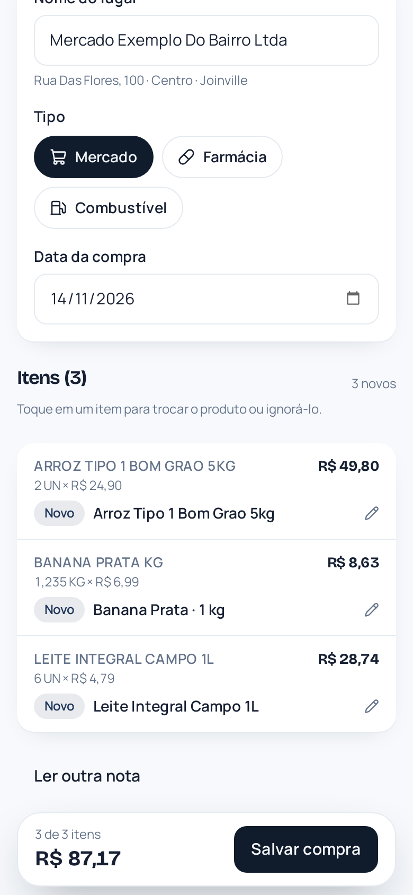
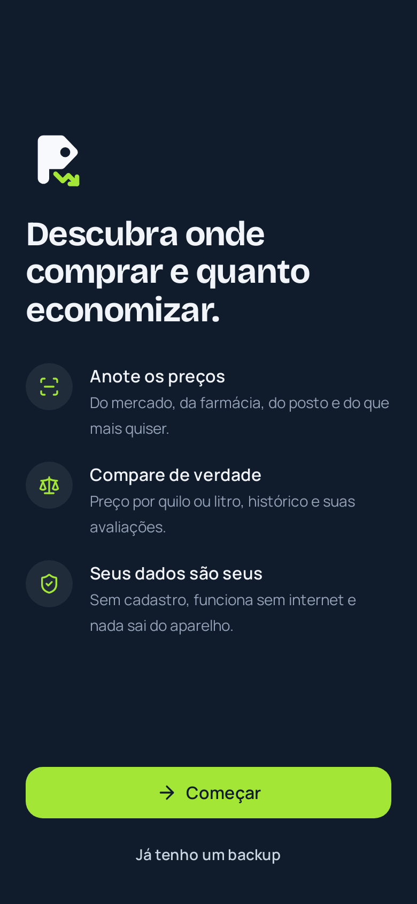
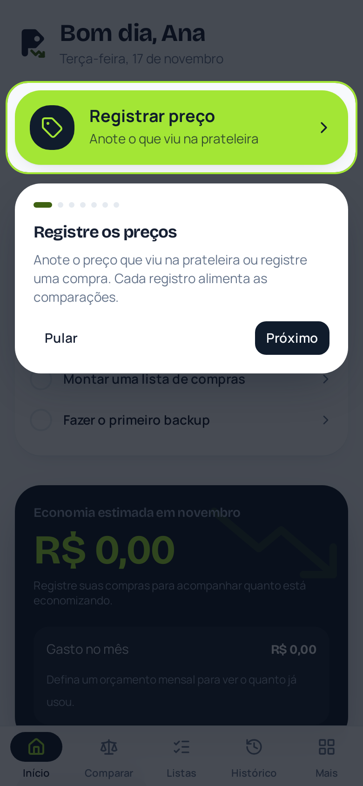
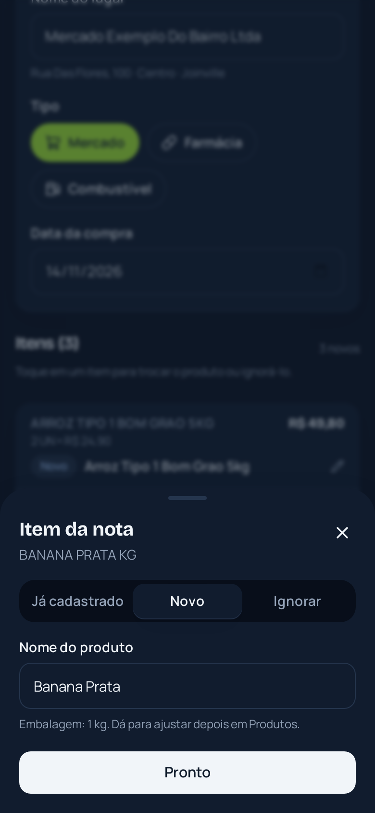

<p align="center">
  
</p>

<p align="center"><strong>Sua economia começa aqui.</strong><br/>
Descubra onde comprar, o que comprar e quanto economizar.</p>

---

O **Precivora** é um app de inteligência de consumo **local-first**: você escaneia a nota fiscal ou anota os preços que encontra (no mercado, na farmácia, no posto ou em qualquer lugar que quiser cadastrar), avalia o que compra e o app mostra onde está mais barato, quanto você economiza e qual produto vale mais a pena. Não precisa de conta. **Os dados ficam no seu aparelho.** Roda como app Android e como PWA no navegador, com o mesmo código.

<p align="center">
  
  
  
  
</p>

<p align="center">
  
  
  
  
</p>

<p align="center"></p>

<sub>As capturas usam dados fictícios de demonstração, inclusive a nota fiscal.</sub>

## O que ele faz

| Módulo | O que tem |
|---|---|
| **Primeira abertura** | Boas-vindas com o nome perguntado uma única vez e apresentação guiada que passa pelas telas destacando cada parte. Dá para rever nos Ajustes. |
| **Início** | Atalho grande para escanear a nota (no app) ou registrar preço, primeiros passos com progresso (some ao concluir ou ao ocultar), economia estimada do mês, orçamento, oportunidades (produtos abaixo da sua média), combustível mais barato, últimos preços e atividade. |
| **Nota fiscal (NFC-e)** | No app Android: escaneia o QR Code do cupom (ou digita a chave), abre a consulta no site da Fazenda dentro do app e lê lugar, itens, quantidades e valores. Na conferência, cada item vira produto novo (nome legível e embalagem sugerida), produto já cadastrado ou é ignorado. O lugar é reconhecido pelo CNPJ, os produtos pelos vínculos das notas anteriores e por semelhança com o que já está cadastrado (“ARR TIO JOAO T1 5KG” encontra “Arroz Tio João 5 kg”, sem juntar tamanhos diferentes), e a mesma nota não entra duas vezes. Nota de posto vira preço de combustível. Só aceita QR Code de site da Fazenda (.gov.br). Feito para Santa Catarina; o leitor segue o layout nacional da consulta. |
| **Lugares e tipos** | Mercado, Farmácia e Combustível vêm prontos; você cria outros tipos (Pet shop, Padaria, Construção…) com ícone e cor. Lugares ilimitados de cada tipo, com cor, bairro, cidade e ativo/inativo. |
| **Itens** | Cadastro genérico: só o nome é obrigatório, foto opcional. Em “Mais detalhes”: marca, categoria (por tipo de lugar), código de barras e embalagem em kg/g/L/ml/unidade/pacote/caixa/dúzia para comparar por unidade. Arquivar, editar e excluir. Pelo código de barras (lido pela câmera no app ou digitado), busca nome, marca, embalagem e foto nas bases abertas [Open Food Facts](https://world.openfoodfacts.org) e irmãs e avisa se o código já é de outro produto. |
| **Registro de preço** | Formulário rápido com busca de produto, “salvar e próximo”, preço por unidade calculado na hora e variação contra o último preço (ex.: R$ 25,90 → R$ 23,90 = −7,72%). Suporta “leve 3 por R$ 10”. |
| **Comparador** | Filtro por tipo de lugar, busca, filtros (categoria, marca, lugar, período, faixa de preço, promoções) e ordenação. Separa **menor preço recente**, **menor histórico** e **preço confirmado em compra**; marca preços desatualizados; avisa quando produtos medidos de jeitos diferentes não são comparáveis. |
| **Sugestões** | Ranking explicado que combina sua nota, o preço por unidade, a tendência e suas preferências (favorito, “não comprar novamente”). Um produto barato com nota ruim não é recomendado em primeiro. |
| **Combustíveis** | Tipo especializado: postos com bandeira, sete combustíveis, ranking do último preço anotado por posto, diferença por litro, economia em 30/40/50 L (configurável) e calculadora flex com rendimento editável (70% é só referência) ou por km/L. No app, traz os preços oficiais do levantamento semanal da ANP para os postos cadastrados (pelo CNPJ) e cadastra os postos pesquisados nas cidades onde você já tem posto; dá para atualizar sozinho no Wi-Fi. |
| **Mapa e “perto de mim”** | Os endereços dos lugares viram pontos no mapa sozinhos (OpenStreetMap, em segundo plano, marcando se o ponto é exato ou aproximado). Mapa com filtros por tipo, favoritos e combustível, com o preço de cada posto na etiqueta, “Perto de mim” e atalho para rotas. No app, se a localização do celular estiver desligada, ele explica para que serve e liga pela janela do Google, sem sair do app. Em Combustíveis, filtro por distância (até 2, 5, 10 ou 20 km) e distância em cada posto. |
| **Favoritos** | Estrela no lugar: aparece primeiro na escolha de lugar e tem filtro próprio em Lugares, Combustíveis e no Mapa. |
| **Avaliações** | Notas pessoais de produto e de marca (geral, qualidade, custo-benefício), comentário, favorito e “não comprar novamente”. |
| **Listas** | Itens com quantidade e prioridade, marcar comprado, duplicar, arquivar. Comparador da lista inteira: total por lugar (pode misturar mercado e farmácia), compra dividida otimizada **com custo de deslocamento** e preferência por um único lugar. |
| **Histórico** | Escanear nota ou registrar compra sem nota, compras reais (viram preço confirmado), gasto por mês, categorias com mais gastos, produtos que mais subiram e caíram, exportação CSV. |
| **Orçamento** | Orçamento mensal, meta de economia e limite por categoria com alerta em 80% e 100%. |
| **Backup** | Exporta tudo em JSON (no celular, "Enviar backup" abre o compartilhamento: Drive, WhatsApp, e-mail) e guia a troca de celular; importa validando estrutura, versão e integridade, mostrando o resumo antes; modos *mesclar* (sem duplicar) e *substituir tudo*. No app, backup automático em Documentos/Precivora/Automatico: liga e desliga, intervalo (1 a 30 dias), quantas cópias guardar, onde ficam, tamanho, último e próximo. |
| **PWA** | Instalável, funciona offline, aviso de nova versão (atualizar não apaga os dados), tema claro/escuro/automático com `theme-color` sincronizado. |

## Rodar localmente

Requer Node.js **20 LTS ou superior** (o projeto também foi testado no Node 18.20).

```bash
npm install
npm run dev          # http://localhost:5173
```

| Comando | O que faz |
|---|---|
| `npm run dev` | Servidor de desenvolvimento |
| `npm run build` | Checagem de tipos + build de produção em `dist/` (com service worker) |
| `npm run preview` | Serve o build de produção |
| `npm test` | Testes unitários e de integração (Vitest + IndexedDB simulado) |
| `npm run test:e2e` | Testes ponta a ponta no Chromium (Playwright) sobre o build. Rode `npm run build` antes; `SCREENSHOTS=pasta` salva as capturas |
| `npm run icons` | Regenera logotipo, ícones, favicon e imagem social a partir de `scripts/brand.mjs` |
| `npm run typecheck` | Só a checagem de tipos |

Para o e2e, o Playwright precisa do Chromium: `npx playwright install chromium`.

### App Android

O mesmo código vira um app Android de verdade com [Capacitor](https://capacitorjs.com) (pasta `android/`). No app, os dados ficam dentro dele (não no armazenamento do Chrome), a abertura tem animação da marca, a nota fiscal e o código de barras dos produtos são lidos pelo leitor do Google (sem pedir permissão de câmera) e consultada numa tela própria, o backup usa o compartilhamento do Android e salva em `Documentos/Precivora`, o botão voltar fecha painéis e o tema segue o modo escuro do sistema.

Requer JDK 17 e o Android SDK (`ANDROID_HOME` apontando para ele).

**Baixar o app:** a página [Releases](https://github.com/Eduardochimchek/precivora/releases) tem o APK assinado de cada versão. No celular, baixe o `.apk` e toque nele; atualizar por cima mantém os dados.

**Gerar a versão final (assinada):**

- No GitHub: o fluxo `App Android` (`.github/workflows/android-release.yml`) roda ao enviar uma tag `v*` ou pelo botão *Run workflow* em Actions. Ele testa, compila, assina e publica o APK em Releases. A chave fica nos segredos do repositório (`ANDROID_KEYSTORE_BASE64`, `ANDROID_KEYSTORE_PASSWORD`, `ANDROID_KEY_ALIAS`, `ANDROID_KEY_PASSWORD`), nunca no código.
- Na máquina: `npm run android:release` usa `android/keystore.properties` (fora do git) e gera `android/app/build/outputs/apk/release/app-release.apk`.

A versão (`versionCode`) é o número de commits, então cada build novo atualiza o anterior.

**Versão de teste:** `npm run android:apk` gera o app **Precivora Dev** (`app.precivora.dev`), que instala ao lado do app de verdade, com dados separados:

```bash
npm run android:apk
adb install -r android/app/build/outputs/apk/debug/app-debug.apk
```

`npm run icons:android` regenera ícones e tela de abertura a partir da marca.

> A chave de assinatura não pode ser perdida: sem ela, uma versão nova não instala por cima e é preciso desinstalar (perdendo os dados que não estiverem em backup). Guarde a chave e as senhas num lugar seguro, fora deste computador.

### Publicar

O build é estático (`dist/`) e usa rotas com `#`, então funciona em qualquer hospedagem de arquivos (GitHub Pages, Netlify, Cloudflare Pages, um servidor nginx). O service worker exige HTTPS (ou `localhost`).

## Privacidade

- Sem login, sem servidor do Precivora, sem anúncios, sem rastreadores.
- Tudo fica no **IndexedDB** do aparelho (no app Android, dentro do próprio app). O PWA pede armazenamento persistente para reduzir o risco de o navegador apagar os dados.
- Desinstalar o app, limpar os dados do navegador ou trocar de aparelho **apaga os registros**. Por isso o app lembra de fazer backup, mostra quando foi o último e, no celular, envia o arquivo pelo compartilhamento do sistema.
- Acessos à internet, sempre por ação sua: a consulta da nota fiscal, feita direto no site da Secretaria da Fazenda (o app só lê a página que a Fazenda mostra), a busca de produto pelo código de barras no Open Food Facts (vai só o número do código), os preços do levantamento semanal da ANP (download do arquivo público, no botão “Atualizar” ou sozinho no Wi-Fi se você ligar), a localização dos endereços dos lugares no OpenStreetMap (Nominatim; vai só o endereço do lugar, um pedido por segundo, sozinho em segundo plano) e as imagens do mapa do OpenStreetMap quando você abre o Mapa. A sua localização só é pedida quando você toca em “Perto de mim” e fica no aparelho, usada para calcular distâncias, o leitor de códigos do Google Play, baixado pelo próprio Android na primeira vez, e o “Abrir no mapa” de um lugar com endereço.

## Arquitetura

React 18 + TypeScript + Vite, Tailwind CSS, Dexie (IndexedDB), Recharts, Lucide, Zod e vite-plugin-pwa (Workbox). Veja [docs/ARQUITETURA.md](docs/ARQUITETURA.md).

```
src/
  app/            inicialização, configurações, instalação PWA
  components/     casca (navegação, cabeçalho, aviso de atualização, erros)
  design-system/  tokens, botões, campos, sheet/diálogo, toasts, estrelas, etiqueta de preço, gráficos
  db/             esquema Dexie, versões e migrações
  repositories/   gravação com validação (produtos, lugares, preços, compras, listas, avaliações...)
  services/       regras de negócio puras (unidades, comparação, combustível, otimizador de lista,
                  recomendações, análises, backup, CSV, tema)
  features/       telas por módulo
  hooks/ utils/ types/ styles/ tests/
```

## Roadmap

A **Fase 1 (MVP)** está completa, com app Android e importação de nota fiscal de SC. As próximas fases (alertas de preço, leitor de código de barras, notas de outros estados, backup automático na nuvem, contas, sincronização, preços colaborativos, dados públicos da ANP) estão em [docs/ROADMAP.md](docs/ROADMAP.md).

## Marca

Logotipo, símbolo e ícones são originais e ficam em [`public/brand`](public/brand) e [`public/icons`](public/icons) (SVG + PNG): versões clara, escura e monocromática, ícone Android 1024 px, PWA 192/512, maskable e favicon. Fontes: Bricolage Grotesque e Manrope (SIL OFL), empacotadas localmente.

## Licença

[MIT](LICENSE).
