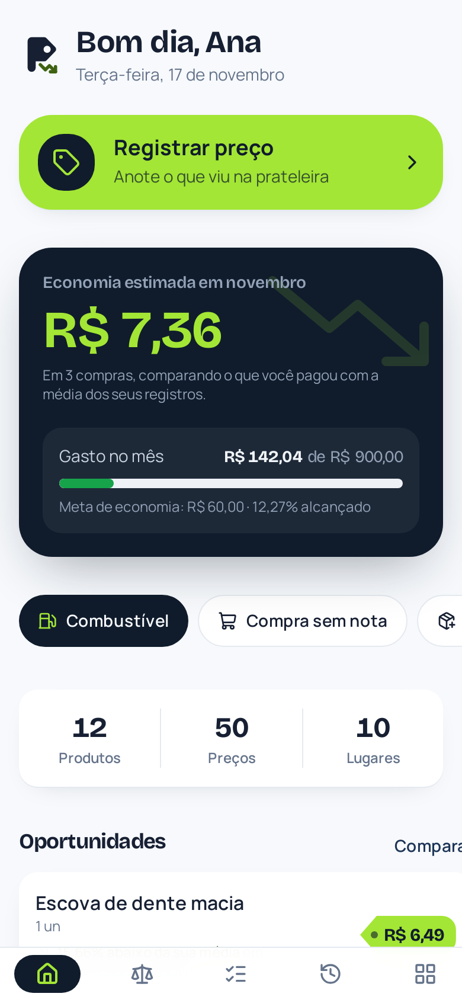
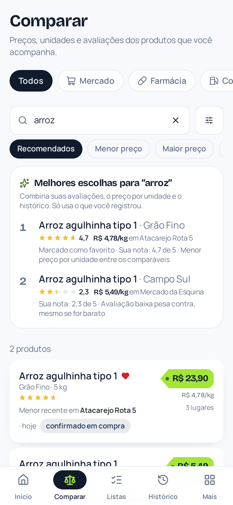
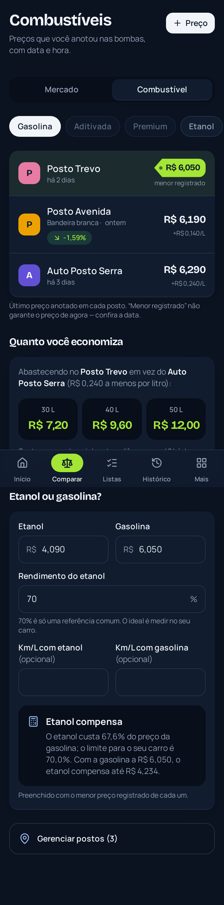
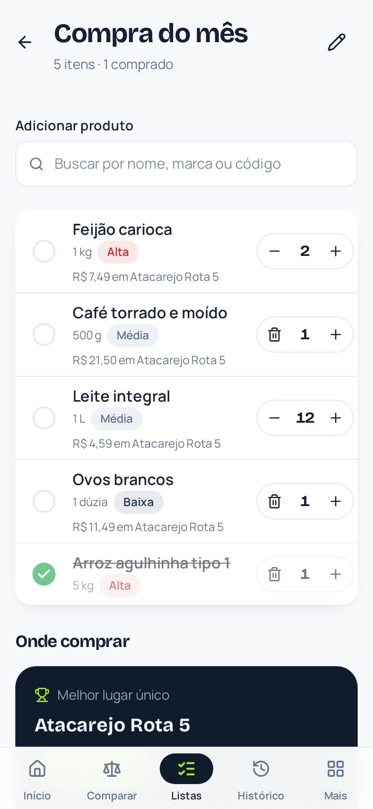
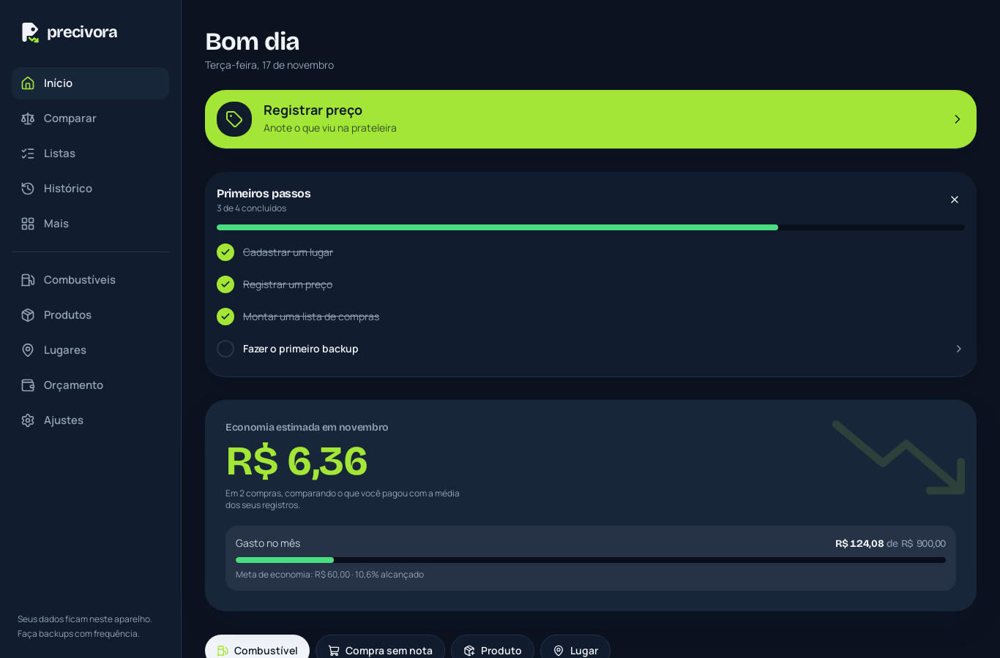

<p align="center">
  
</p>

<p align="center"><strong>Sua economia começa aqui.</strong><br/>
Descubra onde comprar, o que comprar e quanto economizar.</p>

---

O **Precivora** é um app de inteligência de consumo **local-first**: você anota os preços que encontra (no mercado, na farmácia, no posto ou em qualquer lugar que quiser cadastrar), avalia o que compra e o app mostra onde está mais barato, quanto você economiza e qual produto vale mais a pena. Não precisa de conta nem de internet. **Os dados ficam no seu aparelho.**

<p align="center">
  
  
  
  
</p>

<p align="center"></p>

<sub>As capturas usam dados fictícios de demonstração.</sub>

## O que ele faz

| Módulo | O que tem |
|---|---|
| **Início** | Economia estimada do mês, orçamento, oportunidades (produtos abaixo da sua média), combustível mais barato, últimos preços e atividade. Onboarding quando o banco está vazio. |
| **Lugares e tipos** | Mercado, Farmácia e Combustível vêm prontos; você cria outros tipos (Pet shop, Padaria, Construção…) com ícone e cor. Lugares ilimitados de cada tipo, com cor, bairro, cidade e ativo/inativo. |
| **Itens** | Cadastro genérico: só o nome é obrigatório, foto opcional. Em “Mais detalhes”: marca, categoria (por tipo de lugar), código de barras e embalagem em kg/g/L/ml/unidade/pacote/caixa/dúzia para comparar por unidade. Arquivar, editar e excluir. |
| **Registro de preço** | Formulário rápido com busca de produto, “salvar e próximo”, preço por unidade calculado na hora e variação contra o último preço (ex.: R$ 25,90 → R$ 23,90 = −7,72%). Suporta “leve 3 por R$ 10”. |
| **Comparador** | Filtro por tipo de lugar, busca, filtros (categoria, marca, lugar, período, faixa de preço, promoções) e ordenação. Separa **menor preço recente**, **menor histórico** e **preço confirmado em compra**; marca preços desatualizados; avisa quando produtos medidos de jeitos diferentes não são comparáveis. |
| **Sugestões** | Ranking explicado que combina sua nota, o preço por unidade, a tendência e suas preferências (favorito, “não comprar novamente”). Um produto barato com nota ruim não é recomendado em primeiro. |
| **Combustíveis** | Tipo especializado: postos com bandeira, sete combustíveis, ranking do último preço anotado por posto, diferença por litro, economia em 30/40/50 L (configurável) e calculadora flex com rendimento editável (70% é só referência) ou por km/L. |
| **Avaliações** | Notas pessoais de produto e de marca (geral, qualidade, custo-benefício), comentário, favorito e “não comprar novamente”. |
| **Listas** | Itens com quantidade e prioridade, marcar comprado, duplicar, arquivar. Comparador da lista inteira: total por lugar (pode misturar mercado e farmácia), compra dividida otimizada **com custo de deslocamento** e preferência por um único lugar. |
| **Histórico** | Compras reais (viram preço confirmado), gasto por mês, categorias com mais gastos, produtos que mais subiram e caíram, exportação CSV. |
| **Orçamento** | Orçamento mensal, meta de economia e limite por categoria com alerta em 80% e 100%. |
| **Backup** | Exporta tudo em JSON (no celular, "Enviar backup" abre o compartilhamento: Drive, WhatsApp, e-mail) e guia a troca de celular; importa validando estrutura, versão e integridade, mostrando o resumo antes; modos *mesclar* (sem duplicar) e *substituir tudo*. |
| **PWA** | Instalável, funciona offline, aviso de nova versão (atualizar não apaga os dados), tema claro/escuro/automático com `theme-color` sincronizado. |

## Rodar localmente

Requer Node.js **20 LTS ou superior** (o projeto também foi testado no Node 18.20).

```bash
npm install
npm run dev          # http://localhost:5173
```

| Comando | O que faz |
|---|---|
| `npm run dev` | Servidor de desenvolvimento |
| `npm run build` | Checagem de tipos + build de produção em `dist/` (com service worker) |
| `npm run preview` | Serve o build de produção |
| `npm test` | Testes unitários e de integração (Vitest + IndexedDB simulado) |
| `npm run test:e2e` | Testes ponta a ponta no Chromium (Playwright) sobre o build. Rode `npm run build` antes; `SCREENSHOTS=pasta` salva as capturas |
| `npm run icons` | Regenera logotipo, ícones, favicon e imagem social a partir de `scripts/brand.mjs` |
| `npm run typecheck` | Só a checagem de tipos |

Para o e2e, o Playwright precisa do Chromium: `npx playwright install chromium`.

### App Android

O mesmo código vira um app Android de verdade com [Capacitor](https://capacitorjs.com) (pasta `android/`). No app, os dados ficam dentro dele (não no armazenamento do Chrome), o backup usa o compartilhamento do Android e salva em `Documentos/Precivora`, o botão voltar fecha painéis e o tema segue o modo escuro do sistema.

Requer JDK 17 e o Android SDK (`ANDROID_HOME` apontando para ele).

```bash
npm run android:apk      # build web + sincroniza + gera android/app/build/outputs/apk/debug/app-debug.apk
adb install -r android/app/build/outputs/apk/debug/app-debug.apk   # instala ou atualiza mantendo os dados
```

`npm run icons:android` regenera ícones e tela de abertura a partir da marca. O APK de depuração é assinado com a chave `~/.android/debug.keystore` da máquina que gerou: uma atualização gerada em outra máquina exige desinstalar (e perder os dados), então faça backup antes. Para a Play Store será preciso uma chave de publicação própria.

### Publicar

O build é estático (`dist/`) e usa rotas com `#`, então funciona em qualquer hospedagem de arquivos (GitHub Pages, Netlify, Cloudflare Pages, um servidor nginx). O service worker exige HTTPS (ou `localhost`).

## Privacidade

- Sem login, sem servidor, sem anúncios, sem rastreadores, sem chamadas de rede com seus dados.
- Tudo fica no **IndexedDB** do navegador. O app pede armazenamento persistente para reduzir o risco de o navegador apagar os dados.
- Limpar os dados do navegador ou trocar de aparelho **apaga os registros**. Por isso o app lembra de fazer backup e mostra quando foi o último.
- O único link externo é o “Abrir no mapa” de um lugar com endereço, e só quando você toca nele.

## Arquitetura

React 18 + TypeScript + Vite, Tailwind CSS, Dexie (IndexedDB), Recharts, Lucide, Zod e vite-plugin-pwa (Workbox). Veja [docs/ARQUITETURA.md](docs/ARQUITETURA.md).

```
src/
  app/            inicialização, configurações, instalação PWA
  components/     casca (navegação, cabeçalho, aviso de atualização, erros)
  design-system/  tokens, botões, campos, sheet/diálogo, toasts, estrelas, etiqueta de preço, gráficos
  db/             esquema Dexie, versões e migrações
  repositories/   gravação com validação (produtos, lugares, preços, compras, listas, avaliações...)
  services/       regras de negócio puras (unidades, comparação, combustível, otimizador de lista,
                  recomendações, análises, backup, CSV, tema)
  features/       telas por módulo
  hooks/ utils/ types/ styles/ tests/
```

## Roadmap

A **Fase 1 (MVP)** está completa. As próximas fases (alertas de preço, leitor de código de barras, importação de nota fiscal, contas, sincronização, preços colaborativos, dados públicos da ANP) estão em [docs/ROADMAP.md](docs/ROADMAP.md).

## Marca

Logotipo, símbolo e ícones são originais e ficam em [`public/brand`](public/brand) e [`public/icons`](public/icons) (SVG + PNG): versões clara, escura e monocromática, ícone Android 1024 px, PWA 192/512, maskable e favicon. Fontes: Bricolage Grotesque e Manrope (SIL OFL), empacotadas localmente.

## Licença

[MIT](LICENSE).
